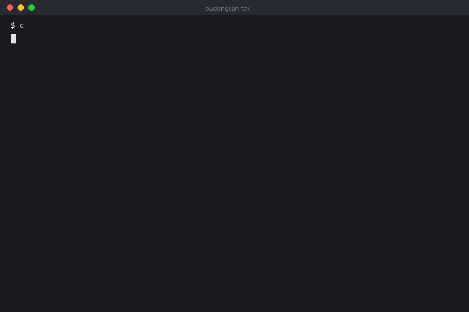

# budongsan-tax

mcp-name: io.github.taylee9809/budongsan-tax

**한국 부동산 세금의 요건 판정과 세액 계산을 지원하는 오픈소스 MCP 서버입니다.**

취득세, 재산세, 종합부동산세, 양도소득세, 주택임대소득세, 부동산 증여세·상속세 및 재건축부담금을 다룹니다.
법령의 조문별 요건을 코드로 구현하고, 계산 결과와 함께 적용 근거를 확인할 수 있도록 설계했습니다.

결과에는 적용 조문, 검토 후 적용하지 않은 조문과 그 사유, 입력값의 출처 등급을 제공합니다.
국세청·조세심판원·행정안전부의 공식 해석례와 재결례를 회귀 검증 자료로 활용합니다.



*English.* Korean real-estate tax engine and MCP server: acquisition, property, comprehensive holding,
capital gains, rental income, gift and inheritance tax, reconstruction levy. 43 tools,
2736 statute nodes (one function per article or paragraph), official rulings as regression tests.
Every result carries the statute trail. English README: [`README-EN.md`](README-EN.md). Tool list: [`llms.txt`](llms.txt).

## 구현 및 검증 현황

| 항목 | 규모 |
|---|---|
| MCP 도구 | 43 |
| 실행 노드 | 2736 (조·항·호 단위의 실행 함수) |
| 전환 대기 조문 | 조 단위 0 (수록된 법문 코퍼스의 세액 영향 조문 기준, 코퍼스 밖 미착수 4) · 호·목 단위 0 (노드 없는 형제 110개 모두 사유 기록). 제목 분류 때문에 이 집계에 들지 않는 코퍼스 조문 20개는 [`docs/NODE_COVERAGE.md`](docs/NODE_COVERAGE.md)의 '요약표에 들지 않는 조문' 참고 |
| 회귀 케이스 / 해석례 / 결함 기록 | 558 / 1371 / 94 |

위 수치는 저장소에 수록된 구현과 검증 자료의 규모입니다. 전체 세법의 지원 범위나 테스트 통과 건수를 의미하지 않습니다.

## 구성

| 구분 | 주요 파일·경로 | 역할 |
|---|---|---|
| 세율·계수 | `data/tax_params.json`, `tax_params.py` | 연도별 세율, 비율 및 상한 관리. 검증되지 않은 연도의 값은 반환하지 않습니다. |
| 법령 원문 | `data/legal_nodes/` | 조문 원문과 시행일 보관. 계산 결과의 근거와 연결합니다. |
| 판정·계산 도구 | `tax_judgment.py`, `tax_server.py`, `entity_tax.py` | 도구 43개. 세목별 요건 판정과 세액 계산을 제공합니다. |
| 호스팅 전용 도구 | `acquisition_checklist.py`, `corporate_tax.py`, `building_property_tax.py`, `tax_scope.py`, `tax_http.py` | HTTP 서버에만 붙는 도구 7개(취득세 입력 체크리스트, 범위 안내, 법인의 취득세·종부세·부동산 양도 법인세·비사업용 토지 판정, 건축물 재산세). 질문 단위 채점표는 [`docs/QUESTION_CASES.md`](docs/QUESTION_CASES.md). |
| 조문별 실행 노드 | `tax_nodes/` | 조문 단위 함수를 조합하여 판정과 계산을 수행합니다. 기존 계산 로직을 이 구조로 이관하고 있습니다. |
| 검증 | `data/verification/`, `tax_case_store.py` | 회귀 케이스, 결함 기록 및 해석례 관리 |

조문별 이관 상태는 [`docs/NODE_COVERAGE.md`](docs/NODE_COVERAGE.md)에서 확인할 수 있습니다.
세목별 검증 결과와 불일치 건수는 [`docs/BENCH.md`](docs/BENCH.md), 조문 근거를 포함한 출력 예시는 [`docs/EXAMPLE.md`](docs/EXAMPLE.md)에 수록되어 있습니다.
법문 코퍼스에 포함되지 않은 조문은 원문 확보와 구현·검증이 추가로 필요합니다.

## 설치 및 실행

PyPI 패키지를 제공합니다. `uv`가 설치된 환경에서는 다음 명령으로 실행할 수 있습니다.

```bash
uvx budongsan-tax
```

Claude Code 등록 명령: `claude mcp add budongsan-tax -- uvx budongsan-tax`

소스 코드에서 실행하려면 다음 명령을 사용합니다.

```bash
pip install -r requirements.txt
cp .env.example .env      # 법령·해석례 조회 시 LAW_OC 설정 필요. 세액 계산은 키 없이 사용 가능
python tax_server.py      # stdio MCP 서버
```

Claude Code:

```bash
claude mcp add budongsan-tax -- python /절대경로/tax_server.py
```

Claude Desktop `claude_desktop_config.json`:

```json
{"mcpServers": {"budongsan-tax": {"command": "python", "args": ["/절대경로/tax_server.py"]}}}
```

회귀 테스트용 데이터베이스 구성 및 테스트 실행(선택):

```bash
python scripts/verification_sync.py --rebuild
python -m pytest tests
```

## 도구 안내

| 접두사 | 기능 |
|---|---|
| `judge_*` | 세대, 주택 수, 비과세·감면 요건 등을 판정합니다. |
| `calc_*` | 입력값과 관련 판정 결과를 바탕으로 세액을 계산합니다. |
| `count_*` | 해당 기준에 따른 주택 수를 산정합니다. |
| `search_*`, `get_*` | 법령·조례·해석례를 조회합니다. 조회 도구에는 `LAW_OC` 설정이 필요합니다. |

요건 판정이 필요한 계산은 관련 `judge_*` 도구의 결과를 먼저 확인한 뒤 진행합니다.

전체 도구 목록과 설명은 [`llms.txt`](llms.txt)를 참고하십시오.

이 프로젝트는 요건 판정과 세액 계산을 코드로 수행하고, 그 근거 조문을 결과에 연결합니다.
법령·해석례 검색 도구와 함께 사용하여 원문 확인과 계산 결과 검토를 진행할 수 있습니다.

HTTP 방식으로 실행하려면 `MCP_TRANSPORT=streamable-http budongsan-tax` 명령 또는 `Dockerfile`을 사용합니다.
엔드포인트는 `/mcp`이며, 기본 서버에는 인증 기능이 포함되어 있지 않습니다.
각 도구에는 `title`과 `readOnlyHint` 메타데이터가 포함되어 있습니다.

## 사용 범위와 한계

이 프로젝트는 세무 검토를 지원하는 소프트웨어이며, 세무대리나 개별 사안에 대한 전문 자문을 제공하지 않습니다.
결과를 활용할 때는 입력 사실관계, 적용 시점의 법령 및 해당 도구의 지원 범위를 확인해야 합니다.
신고·불복 등 실제 절차에 사용할 경우 세무사 또는 변호사의 검토를 받으십시오.

결과의 정확성을 보증하지 않으며, 보증 및 책임에 관한 사항은 AGPL 제15조·제16조를 따릅니다.

## 기여

기여 방법은 [`CONTRIBUTING.md`](CONTRIBUTING.md)에 안내되어 있습니다.
오류가 발생한 입력값, 기대 결과, 실제 결과와 근거 자료를 제공해 주시면 재현과 검증에 도움이 됩니다.
코드 수정 없이도 사례 제보와 문서 개선으로 참여할 수 있습니다.

## 출처와 저작권

- 법령, 시행령, 조례: 법제처 국가법령정보. 저작권법 제7조 제1호에 따른 저작권 보호 제외 자료입니다.
- 조세심판원 결정, 국세청·행안부 해석례: 저작권법 제7조 제2호·제3호 관련 자료입니다. 발행 기관이 비식별 처리한 자료에
  숫자 패턴 정제를 추가 적용한 요약을 수록합니다(`scripts/sanitize_public_text.py`). 본문은 SHA-256 해시로 관리합니다.
- 이 저장소의 코드, 노드, 케이스: AGPL-3.0-or-later

## 라이선스

GNU Affero General Public License v3.0 or later를 적용합니다.
수정본을 네트워크 서비스로 제공하는 경우 등 이용·수정·배포 시의 의무는 [라이선스 전문](LICENSE)을 확인하십시오.
별도 라이선스가 필요한 경우 저장소 관리자에게 문의하십시오.

---
생성: `scripts/package_opensource.py` (원본 git 6116176)
